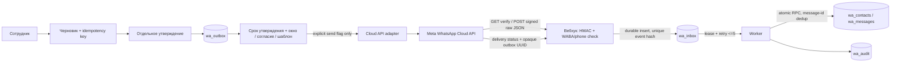

# WhatsApp — архитектура подготовлена, подключение отложено

Текущий режим: `prepared`. На production не применялась миграция WhatsApp,
не настраивались Meta-ключи, не подключался номер и не отправлялись сообщения.
Панель сотрудников показывает подготовку, а не фиктивное «подключено».
Это отдельный канал ручного общения; автоматические уведомления о тендерах
не включаются (по требованию владельца).

## Поток данных

## Компоненты и гарантии

- `domain.js`: нормализация входящих, проверка подписи, номера/аккаунта, валидация
  черновиков и политика допустимой отправки. Входящее не считается согласием на
  бизнес-сообщения; STOP/СТОП/отписаться отзывают согласие.
- `router.js`: публичный webhook `/api/integrations/whatsapp/webhook`; монтируется
  **до** общего JSON-парсера для проверки подписи исходных байтов. Лимит 256 КБ,
  ограничение частоты, challenge только при правильном verify-token.
- `store.js`: только серверный Supabase. Ошибка сохранения события означает 503,
  не ложный ACK. Повтор точного события не дублирует inbox; другой конверт с тем же
  message id также не дублирует сообщение.
- `worker.js`: входящие обрабатываются с lease и ограниченными повторами;
  данные сообщения/контакта/статуса и завершение inbox фиксируются атомарно RPC.
  Повтор старого delivery status не понижает read до sent.
- `provider.js`: официальный Graph API, версия указывается при подключении,
  без предположения о «текущей» версии. Никаких WhatsApp Web/QR-сессий или
  неофициальных шлюзов. Текст и утверждённые шаблоны с body text-параметрами.
  Медиа не скачиваются автоматически; входящие метаданные сохраняются как данные.
- Исходящее: `draft → approved → sending → sent/failed/uncertain`.
  Утверждение действует 15 минут; worker повторно проверяет контакт и условия.
  Тайм-аут, ошибка сети, неполное подтверждение или зависшая sending-запись
  переводят результат в uncertain, без автоматической повторной отправки.
  `biz_opaque_callback_data` связывает webhook-статус с записью очереди для сверки.
  Это не обещание exactly-once со стороны Meta: при неопределённости нужна сверка.
- Текстовый ответ — внутри 24 часов с входящего обращения, если нет отказа.
  Бизнес-сообщение через шаблон — только с зарегистрированным согласием и
  шаблоном в approved. Отправка всегда требует отдельного утверждения сотрудника.
- Статус «configured» отражает настройки, а не проверенную подписку Meta.
  Признак connected появляется только после подписанного и сохранённого события.

## Хранилище и границы доступа

Миграция `migrations/20261118113937_whatsapp_architecture.sql` **только подготовлена**.
Таблицы: контакты/согласия, шаблоны, inbox, outbox, сообщения, аудит.
RLS включён, PUBLIC/anon/authenticated не имеют доступа к таблицам и RPC.
Серверная service_role имеет необходимые права, аудит — только SELECT/INSERT.
Секреты не хранятся в таблицах, публичном JavaScript, статусе или логах ошибок.
Доступ к панели и черновикам — через существующую проверку сотрудников Sultan Trade;
административного sync-secret недостаточно для создания/утверждения сообщений.

Это схема для одного действующего бизнеса/проекта Supabase. Перед подключением
других компаний нужны tenant_id и отдельное разграничение. Несколько worker-процессов
поддерживаются DB lease/SKIP LOCKED, но исходящая отправка не возобновляется вслепую.

## Серверные API

| Маршрут | Назначение сейчас |
|---|---|
| GET /api/tenders/whatsapp/status | Архитектура и отключённое состояние |
| POST /api/tenders/whatsapp/drafts/preview | Валидация без записи/отправки |
| POST /api/tenders/whatsapp/drafts | После отдельного подключения; idempotencyKey + draft |
| POST /api/tenders/whatsapp/drafts/:id/approve | После подключения; только draft, отдельный акт сотрудника |
| GET/POST /api/integrations/whatsapp/webhook | Отключён, пока не включены серверные параметры |

В режиме prepared нет работы с контактами и очередями production. Ни один маршрут
не принимает произвольный URL поставщика или секрет из браузера.

## Этап подключения — позже

1. Согласовать номер бизнеса, Meta Business/WABA, доступ приложения и поддерживаемую
   версию Graph API. Настроить отдельные серверные секреты и права минимального объёма.
2. На тестовом проекте применить миграцию. Проверить таблицы/RLS/RPC и восстановление
   worker после сбоя; не включать приём до готового хранилища.
3. Настроить хранение/удаление персональных данных, резервные копии, права сотрудников
   и основание согласия. Срок хранения raw inbox/message content определить до приёма.
   В текущем режиме данных клиентов нет. Удаление и очистка не запускаются автоматически.
4. Зарегистрировать шаблоны у Meta, перенести их реальные статусы/языки и сведения о
   согласиях клиентов в серверное хранилище. Нельзя выдавать локальный черновик за
   утверждение Meta. Смена номера/аккаунта — после разбора старой очереди.
5. Настроить webhook HTTPS, проверить challenge/подпись и входящее тестовое событие.
   Проверить повтор события, ошибку БД и delivery statuses.
6. Только после проверки утвердить один тестовый черновик и отдельно включить отправку.
   Проверить неопределённый результат, opt-out и истечение окна/утверждения.
7. Отдельно развивать рабочий интерфейс переписки/справочников; сейчас публикуется
   видимая панель архитектуры, а не имитация рабочего чата.

### Переменные окружения

По умолчанию `WHATSAPP_MODE=prepared`, `WHATSAPP_SEND_ENABLED=false`.
На этапе подключения: `WHATSAPP_MODE=enabled`, `WHATSAPP_VERIFY_TOKEN`,
`WHATSAPP_APP_SECRET`, `WHATSAPP_PHONE_NUMBER_ID`, `WHATSAPP_WABA_ID`.
Для отдельно разрешённой отправки: `WHATSAPP_SEND_ENABLED=true`,
`WHATSAPP_GRAPH_VERSION`, `WHATSAPP_ACCESS_TOKEN`.
Не использовать префикс VITE_ для этих значений и не передавать их в чат.

## Проверки

`npm run test:tenders` включает локальный PostgreSQL/PGlite: RLS/GRANT, дедупликация,
идемпотентный ключ черновика, запрет повторного утверждения, uncertain-состояние
и сверка delivery statuses. Также проверяются HMAC на исходных байтах, 24-часовое
окно, согласие, шаблон и отсутствие сетевых вызовов в prepared-режиме.
Тесты не обращаются к реальному номеру и не требуют Meta-ключей.

Документация протокола:
https://developers.facebook.com/docs/graph-api/webhooks/getting-started
https://developers.facebook.com/docs/whatsapp/cloud-api/webhooks
https://developers.facebook.com/docs/whatsapp/cloud-api/reference/messages
